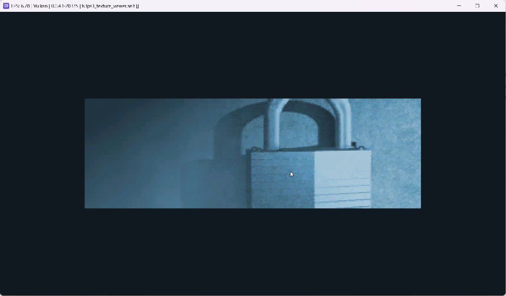

# Halo PS3 Recomp

Investigación experimental para estudiar los recursos de Halo 3 de Xbox 360 y desarrollar componentes homebrew para PlayStation 3.

**Halo 3 todavía no se ejecuta en PS3. No existe un port jugable ni una recompilación completa del motor.** El nombre expresa el objetivo del proyecto, no un resultado alcanzado. Las pruebas actuales se realizaron en RPCS3; no se ha validado una consola física.

## Estado comprobado

| Componente | Resultado |
| --- | --- |
| Compilación C para PS3 | SELF generado con PS3DK |
| Índices de mapas | 25 mapas; 251.128 entradas comparadas con Python |
| Metadatos de imágenes | 34.136 registros comparados |
| Recursos comprimidos | Páginas Deflate leídas y descomprimidas en PPU |
| Primera imagen | Textura DXT1 real de 284 × 93, presentada mediante GCM |
| Comparación de imagen | 26.412 píxeles idénticos a la referencia independiente |
| Pruebas del decodificador | 8/8; salida del visor 0 |
| Motor, escenas y jugabilidad | Pendientes |



El visor convierte los bloques tiled de Xbox 360, intercambia sus bytes, decodifica BC1 y compone un framebuffer desde CPU. Su presentación mediante GCM no equivale todavía a un pipeline 3D de materiales RSX.

## Entorno utilizado

Windows 11; PS3DK 0.25.0; CMake 4.4.4; Ninja; RPCS3 0.0.43-20375 y firmware 4.93. Las herramientas, el firmware y los datos originales deben obtenerse por separado. El proyecto no los descarga ni los distribuye al compilar.

El entorno local probado usa `C:\H3-PS3`. Varios scripts de análisis y la configuración VFS contienen esa ruta; para otra ubicación deben adaptarse. Colocar las herramientas portátiles bajo `tools/`, como describe [la configuración inicial](docs/CONFIGURACION_INICIAL.md).

Para usar el lector se necesita una copia propia del juego en `HALO 3/maps`, incluido `mainmenu.map`. **No subas esa carpeta ni datos extraídos a este repositorio.** El código abre los mapas solo para lectura.

```powershell
Set-Location C:\H3-PS3
.\scripts\build.ps1 -Target h3ps3_texture_viewer
.\scripts\run-texture-viewer.ps1 -SkipBuild
```

El visor selecciona actualmente `ui\halox\campaign\locked_ui`; presenta 1.800 cuadros y termina. El lanzador exige marcas de éxito en un log nuevo. SELF y archivos temporales se generan en `dist/texture-viewer/` y no se incluyen en Git.

Para regenerar referencias y comparar todos los píxeles, después de ejecutar el visor:

```powershell
python .\scripts\analysis\inspect_tag_index.py --maps '.\HALO 3\maps' --out '.\research\tag-index-reference'
python .\scripts\analysis\verify_texture.py
```

## Documentación y continuidad

- [Primera textura, prueba y límites](docs/TEXTURA_PS3.md).
- [Lector de tags y recursos](docs/LECTOR_TAGS_RECURSOS.md).
- [Lectura inicial de mapas](docs/LECTOR_MAPAS.md).
- [Análisis estático inicial](docs/DECOMPILACION.md): sus resultados históricos no son fuentes C portables. Los proyectos Ghidra y las exportaciones de código del juego permanecen fuera del repositorio.
- [Resultados numéricos](research/texture-validation.json).

Trabajo pendiente: ampliar formatos y páginas de texturas, cargar geometría, implementar materiales y un pipeline 3D, y reconstruir o sustituir los sistemas de entrada, audio, simulación y plataforma. Reconocer recursos no resuelve por sí solo las dependencias del ejecutable de Xbox 360.

## Licencia y contenido

Código GPL-3.0-or-later. Véanse [LICENSE](LICENSE) y [atribuciones](THIRD_PARTY_NOTICES.md). Se usa documentación y código público de proyectos de investigación; no se utilizó código propietario filtrado. No se distribuye el juego, sus assets, firmware, SDK ni exportaciones decompiladas. La captura se incluye como evidencia de la prueba local.
